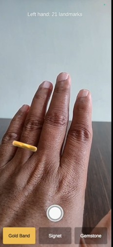
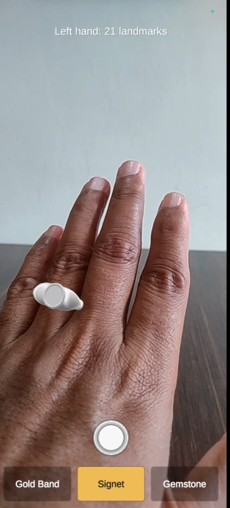
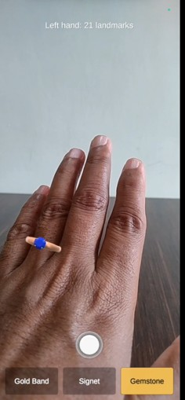

# AR Ring Try-On

An Android app that puts a virtual ring on your finger in real time. It tracks your hand with MediaPipe, seats the ring on your ring finger so it follows every move, hides the part behind your finger, and saves a clean photo to your gallery.

Solo portfolio project. Design, integration and testing by me; built with [Claude Code](https://claude.com/claude-code) assistance.

[](https://youtu.be/TzItExuGbWg)

## Screenshots

| Gold band | Signet | Gemstone |
| :---: | :---: | :---: |
|  |  |  |

## Features

- **Real-time hand tracking.** MediaPipe's hand landmarker finds 21 joints per frame on the phone's camera feed, using the GPU on Android.
- **A ring that sits on the finger.** It is placed along the first bone of the ring finger, turned to follow the finger, and sized from the spacing of the knuckles, so it grows and shrinks as the hand moves closer or further away.
- **The right way up on either hand.** The ring's head (signet face or gemstone) stays on the back of the finger for left and right hands on both the front and rear cameras.
- **Three ring designs, built in code.** A plain gold band, a silver signet and a rose-gold solitaire with a faceted sapphire. There are no downloaded models; band thickness is tunable.
- **Ring picker.** Tap a button to swap rings instantly.
- **Finger occlusion.** An invisible stand-in for the finger hides the back of the ring, so it looks worn rather than floating.
- **Smooth motion.** One-Euro filtering cuts jitter without adding noticeable lag, and the ring's size changes gradually, so it doesn't shrink when the hand turns edge-on.
- **Photo capture.** The shutter saves the camera image and the ring, with no buttons or debug overlay, to an "AR Ring Try-On" album, with a share option afterwards.
- **Debug overlay.** Double-tap to show or hide the tracked hand skeleton.

## Tech stack

- Unity 6 (6000.3.5f2) with the Universal Render Pipeline
- [MediaPipe Unity Plugin](https://github.com/homuler/MediaPipeUnityPlugin) 0.16.3 (MediaPipe Tasks hand landmarker)
- Unity Input System
- [NativeGallery](https://github.com/yasirkula/UnityNativeGallery) and [NativeShare](https://github.com/yasirkula/UnityNativeShare) for the Android gallery and share sheet
- Android: IL2CPP, ARM64, OpenGL ES 3, minimum API level 25
- NUnit Edit Mode tests

## Architecture

The code is split into layers, each with its own assembly definition, so the tracker, the renderer and the native plugins can each be replaced without touching the rest.

| Layer | Responsibility |
| --- | --- |
| `Core` | Plain C# with no Unity or MediaPipe references: landmark data, ring pose maths, smoothing filters, the finger stand-in's shape, the ring catalogue and selection, and the photo flow. |
| `HandTracking` | The only code that touches MediaPipe. It runs the hand landmarker on the camera feed and converts each result into plain `Core` data. |
| `Rendering` | Camera feed, procedural ring meshes and materials, the depth-only finger occluder, photo rendering and the debug overlay. |
| `UI` | Ring picker, shutter button, messages and the double-tap gesture. |
| `Sharing` | The only code that touches NativeGallery and NativeShare. |
| `App` | The composition root that wires the layers together. |
| `Tests` | 252 Edit Mode tests. |

The camera feed is drawn by one camera and the ring by a second camera stacked on top. The finger occluder writes only to the second camera's depth buffer, so it can hide the back of the ring without cutting into the camera image.

## Tests

The tests cover the logic without needing a device:

- ring position, rotation and scale for straight, rotated and tilted fingers, hands at different distances, and non-square screens;
- the ring head's direction for left and right hands on front and rear cameras;
- the smoothing filters: a steady input stays steady, a step converges without overshoot, and jitter is reduced;
- the occluder's shape and its alignment with the ring;
- the ring meshes: the hole matches the finger at any band thickness, normals are correct, and no triangle faces inwards;
- the ring catalogue, the selection rules and the photo save flow, including permission denial.

Run them in Unity from **Window > General > Test Runner > EditMode > Run All**.

## Build and run

### Requirements

- Unity 6000.3.5f2 with **Android Build Support** (including OpenJDK and the Android SDK and NDK tools)
- An ARM64 Android phone running Android 7.1 (API 25) or later

### 1. Get the MediaPipe Unity Plugin

The plugin is installed from disk and is not part of this repository.

1. Download **v0.16.3** from the [MediaPipe Unity Plugin releases](https://github.com/homuler/MediaPipeUnityPlugin/releases) and extract it. The folder that contains `package.json` is the package.
2. Open `Packages/manifest.json` and change the path on the `com.github.homuler.mediapipe` line to that folder. The path committed here is a local one from my machine and will not exist on yours:

   ```json
   "com.github.homuler.mediapipe": "file:C:/path/to/com.github.homuler.mediapipe-0.16.3/package",
   ```

The hand model the app needs (`Assets/StreamingAssets/hand_landmarker.bytes`) is already in the repository.

### 2. Open the project

Open the folder in Unity Hub with 6000.3.5f2. The Package Manager fetches the remaining packages automatically, including NativeGallery and NativeShare, which are pinned to specific versions in `Packages/manifest.json`:

```json
"com.yasirkula.nativegallery": "https://github.com/yasirkula/UnityNativeGallery.git#v1.9.5",
"com.yasirkula.nativeshare": "https://github.com/yasirkula/UnityNativeShare.git#v1.5.5",
```

Git must be installed and on your PATH for the Package Manager to fetch these.

### 3. Build to Android

1. Open **File > Build Profiles**, select **Android** and click **Switch Platform** if it isn't already active.
2. Check that `Assets/Scenes/RingTryOn.unity` is the only scene in the list.
3. Connect your phone with USB debugging enabled, choose it under **Run Device**, and click **Build And Run**.
4. Allow camera access when asked, then show your hand to the camera.

The player settings this needs (IL2CPP, ARM64, OpenGL ES 3, portrait, Input System) are already set in the project.

## Tuning

These values are on components in the `RingTryOn` scene and can be adjusted live in Play mode:

- **App > Ring Position Along Finger:** where the ring sits between the knuckle (0) and the next joint (1).
- **App > Smoothing:** One-Euro filter settings for position, rotation and scale, plus the maximum rate of size change.
- **Ring > Band:** band thickness and width as fractions of the finger's diameter. These never change the ring's inner size.

## Known limitations

- Android only. iOS is not set up or tested.
- The finger occluder is a tapered tube, so where the band meets the edge of the finger the cut is an approximation.
- Tracking quality depends on lighting and on the whole hand being in view.
- Tested on Android 14.

## Credits

- [MediaPipe Unity Plugin](https://github.com/homuler/MediaPipeUnityPlugin) by homuler, MIT licence.
- MediaPipe and the hand landmarker model by Google, Apache License 2.0.
- [NativeGallery](https://github.com/yasirkula/UnityNativeGallery) and [NativeShare](https://github.com/yasirkula/UnityNativeShare) by Süleyman Yasir Kula, MIT licence.

All ring designs are generic and generated in code.

## Licence

[MIT](LICENSE). The third-party components keep their own licences, as listed above.

## AI-use note

This project is built with Claude Code as a coding assistant: writing C# against my specs, setting up the Unity Editor, scene and build settings, and running the tests. I designed the architecture, reviewed and integrated every change, and tested everything in the Editor and on an Android phone. Nothing here ships without me having read and understood it.
